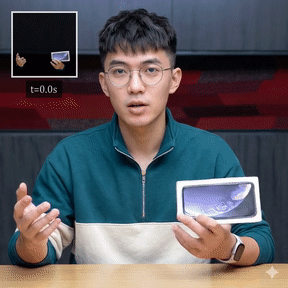
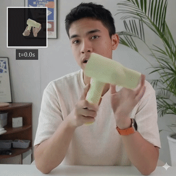
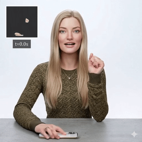

## SparseCtrl-HOI: Sparse Temporal Control for Human-Object Interaction Video Generation<br><sub>Official Implementation</sub>

[](https://arxiv.org/abs/2607.05994)
[](https://mpi-lab.github.io/SparseCtrl-HOI/)
<!-- [](HF_CHECKPOINT_URL)
[](HF_DATASET_URL) -->

This repo contains the PyTorch model definitions, pre-trained weights, and training/inference/evaluation code for our paper
SparseCtrl-HOI: Sparse Temporal Control for Human-Object Interaction Video Generation (ECCV 2026).

> [**SparseCtrl-HOI: Sparse Temporal Control for Human-Object Interaction Video Generation**](https://mpi-lab.github.io/SparseCtrl-HOI/)<br>
> Shenbo Xie, Mingrui Cai, Xu Yang, Yifei Liu, Changxing Ding*
> <br>(*Corresponding Author)
> <br>South China University of Technology

<div align="center">
  <p>
    
    
  </p>
  <p>
    
    
  </p>
  <p><i>Videos generated by SparseCtrl-HOI. The inset in each video shows the sparse interaction keyframe and its designated timestamp. More results with audio are available on the <a href="https://mpi-lab.github.io/SparseCtrl-HOI/">project page</a>.</i></p>
</div>

## Plan

Code, models, and data are released in stages. Boxes are checked as each stage lands.

| Stage | Contents | Status |
| :---: | --- | :---: |
| 0 | Project page, paper | ☑ |
| 1 | Inference: environment, pre-trained weights, inference script, demo samples | ☑ |
| 2 | Data preprocessing pipeline | ☐ |
| 3 | Two-stage training code | ☐ |
| 4 | SparseHOI-5K dataset | ☐ |


## Setup

The code has been tested with Python 3.9, PyTorch 2.5.0 (CUDA 12.1), flash-attn 2.7.4.post1 and transformers 4.57.6 on NVIDIA GPUs (Linux).

First, download and set up the repo:

```bash
git clone https://github.com/MPI-Lab/SparseCtrl-HOI.git
cd SparseCtrl-HOI

conda create -n sparsectrl_hoi python=3.9.23 -y
conda activate sparsectrl_hoi
conda install -c conda-forge ffmpeg -y
```

Install PyTorch before installing the package:

```bash
python -m pip install torch==2.5.0 torchvision==0.20.0 \
  --index-url https://download.pytorch.org/whl/cu121

python -m pip install -e . \
  torch==2.5.0 torchvision==0.20.0 \
  transformers==4.57.6 peft==0.17.1 accelerate==1.10.1 \
  einops==0.8.2 safetensors==0.7.0 librosa==0.11.0 \
  imageio==2.37.2 imageio-ffmpeg==0.6.0 opencv-python==5.0.0.93 \
  Pillow==11.3.0 tqdm==4.70.1 numpy==2.0.2

python -m pip install packaging ninja wheel
python -m pip install flash-attn==2.7.4.post1 --no-build-isolation
```

Qwen2.5-VL is configured to use FlashAttention-2, so `flash-attn` is required. If the installer cannot access GitHub, download a matching wheel from the [FlashAttention release](https://github.com/Dao-AILab/flash-attention/releases/tag/v2.7.4.post1) on the machine and install it locally. For the Python 3.9 / PyTorch 2.5 / CUDA 12 environment above, the wheel used in validation was:

```bash
python -m pip install /path/to/flash_attn-2.7.4.post1+cu12torch2.5cxx11abiFALSE-cp39-cp39-linux_x86_64.whl
```

Use a wheel matching your Python version, PyTorch version, CUDA build, and C++ ABI. A source build requires a compatible CUDA toolkit and compiler; installing the PyTorch CUDA wheel alone does not provide the complete build toolchain.

## Inference

Run all commands below from the repository root with the `sparsectrl_hoi` environment activated.

### Prepare checkpoints

Download the following models and place them under `checkpoints/`. Model weights are not included in the Git repository.

| Model | Source | Local directory |
| --- | --- | --- |
| Wan2.1-T2V-14B | [Hugging Face](https://huggingface.co/Wan-AI/Wan2.1-T2V-14B) | `checkpoints/Wan2.1-T2V-14B/` |
| OmniAvatar-14B | [Hugging Face](https://huggingface.co/OmniAvatar/OmniAvatar-14B) | `checkpoints/OmniAvatar-14B/` |
| Wav2Vec2 Base 960h | [Hugging Face](https://huggingface.co/facebook/wav2vec2-base-960h) | `checkpoints/wav2vec2-base-960h/` |
| Qwen2.5-VL-7B-Instruct | [Hugging Face](https://huggingface.co/Qwen/Qwen2.5-VL-7B-Instruct) | `checkpoints/Qwen2.5-VL-7B-Instruct/` |
| SparseCtrl-HOI-14B | [Hugging Face](https://huggingface.co/Moon-jack/SparseCtrl-HOI-14B) | `checkpoints/SparseCtrl-HOI-14B/` |

The expected layout is:

```text
checkpoints/
├── Wan2.1-T2V-14B/
│   ├── diffusion_pytorch_model-00001-of-00006.safetensors
│   ├── ...
│   ├── diffusion_pytorch_model-00006-of-00006.safetensors
│   └── Wan2.1_VAE.pth
├── OmniAvatar-14B/
│   ├── config.json
│   └── pytorch_model.pt
├── wav2vec2-base-960h/          # Complete model and feature-extractor files
├── Qwen2.5-VL-7B-Instruct/     # Complete model, tokenizer, and processor files
└── SparseCtrl-HOI-14B/
    ├── stage1.ckpt
    ├── stage2.ckpt
    ├── prompt_emb.pt
    └── prompt_emb_negative.pt
```

The SparseCtrl-HOI weights and prompt embeddings must be obtained before running inference; the four upstream model downloads alone are not sufficient.

### Run the examples

Four prepared examples are provided in `assets/examples/`, with their inputs listed in `assets/examples/test_list.txt`.

```bash
CUDA_VISIBLE_DEVICES=0 bash commands/infer.sh
```

The default configuration generates one 121-frame clip per sample at 512 × 512 resolution and 25 fps, using 50 sampling steps, CFG scale 4.5, audio CFG scale 4.5, and seed 1028.

Results are saved under `outputs/examples/`:

```text
outputs/examples/
├── video_512_teaser_05_audio.mp4
├── video_512_teaser_06_audio.mp4
├── video_512_teaser_07_audio.mp4
├── video_512_teaser_09_audio.mp4
└── generated_single/
    ├── teaser_05_audio.mp4
    ├── teaser_06_audio.mp4
    ├── teaser_07_audio.mp4
    └── teaser_09_audio.mp4
```

Files under `generated_single/` contain the generated video with audio. The `video_512_*.mp4` files show the reference image, four interaction keyframes, and generated video side by side, also with audio. You can also try SparseCtrl-HOI with your own inputs.

## Citation
If you find this work useful for your research, please consider citing it.
```bibtex
@inproceedings{xie2026sparsectrl,
  title     = {{SparseCtrl-HOI}: Sparse Temporal Control for Human-Object Interaction Video Generation},
  author    = {Xie, Shenbo and Cai, Mingrui and Yang, Xu and Liu, Yifei and Ding, Changxing},
  booktitle = {Computer Vision -- ECCV 2026},
  series    = {Lecture Notes in Computer Science},
  volume    = {17012},
  pages     = {539--557},
  year      = {2026},
  publisher = {Springer, Cham},
  doi       = {10.1007/978-3-032-37044-0_30},
  url       = {https://doi.org/10.1007/978-3-032-37044-0_30}
}
```

## Acknowledgments
SparseCtrl-HOI has been greatly inspired by the following amazing works and teams: [Wan2.1](https://github.com/Wan-Video/Wan2.1), [OmniAvatar](https://github.com/Omni-Avatar/OmniAvatar), [DiffSynth-Studio](https://github.com/modelscope/DiffSynth-Studio), and [Qwen2.5-VL](https://github.com/QwenLM/Qwen2.5-VL), we thank all the contributors for open-sourcing.

## License
The code and model weights are licensed under [LICENSE](LICENSE.txt).
