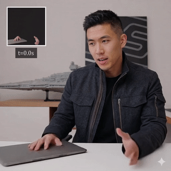
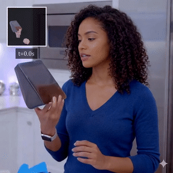
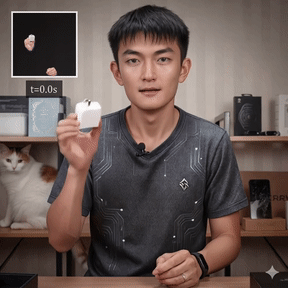

## SparseCtrl-HOI: Sparse Temporal Control for Human-Object Interaction Video Generation<br><sub>Official Implementation</sub>

[](https://arxiv.org/abs/2607.05994)
[](https://mpi-lab.github.io/SparseCtrl-HOI/)
<!-- [](HF_CHECKPOINT_URL)
[](HF_DATASET_URL) -->

This repo contains the PyTorch model definitions, pre-trained weights, and training/inference/evaluation code for our paper
SparseCtrl-HOI: Sparse Temporal Control for Human-Object Interaction Video Generation (ECCV 2026).

> [**SparseCtrl-HOI: Sparse Temporal Control for Human-Object Interaction Video Generation**](https://mpi-lab.github.io/SparseCtrl-HOI/)<br>
> Shenbo Xie, Mingrui Cai, Xu Yang, Yifei Liu, Changxing Ding*
> <br>(*Corresponding Author)
> <br>South China University of Technology

<div align="center">
  <p>
    
    
    
  </p>
  <p>
    
    
    
  </p>
  <p>
    
    
    
  </p>
  <p><i>Videos generated by SparseCtrl-HOI. The inset in each video shows the sparse interaction keyframe and its designated timestamp. More results with audio are available on the <a href="https://mpi-lab.github.io/SparseCtrl-HOI/">project page</a>.</i></p>
</div>

## Plan

Code, models, and data are released in stages. Boxes are checked as each stage lands.

| Stage | Contents | Status |
| :---: | --- | :---: |
| 0 | Project page, paper | ☑ |
| 1 | Inference: environment, pre-trained weights, inference script, demo samples | ☐ |
| 2 | Data preprocessing pipeline | ☐ |
| 3 | Two-stage training code | ☐ |
| 4 | SparseHOI-5K dataset | ☐ |
| 5 | Evaluation protocol and ablation configs | ☐ |

## Citation
If you find this work useful for your research, please consider citing it.
```bibtex
@article{xie2026sparsectrl,
  title={SparseCtrl-HOI: Sparse Temporal Control for Human-Object Interaction Video Generation},
  author={Xie, Shenbo and Cai, Mingrui and Yang, Xu and Liu, Yifei and Ding, Changxing},
  journal={arXiv preprint arXiv:2607.05994},
  year={2026}
}
```

## Acknowledgments
SparseCtrl-HOI has been greatly inspired by the following amazing works and teams: [Wan2.1](https://github.com/Wan-Video/Wan2.1), [OmniAvatar](https://github.com/Omni-Avatar/OmniAvatar), [DiffSynth-Studio](https://github.com/modelscope/DiffSynth-Studio), and [Qwen2.5-VL](https://github.com/QwenLM/Qwen2.5-VL), we thank all the contributors for open-sourcing.

## License
The code and model weights are licensed under [LICENSE](LICENSE).
